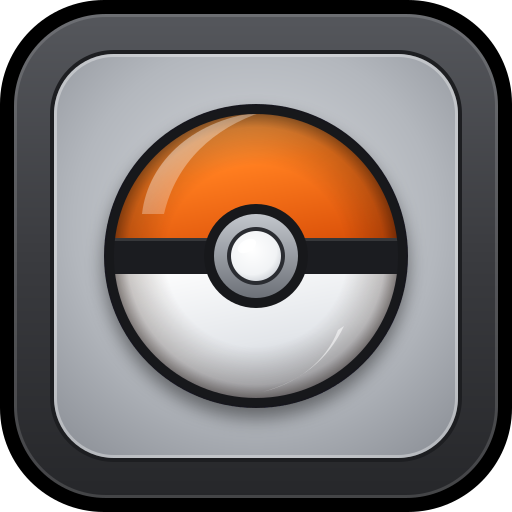

<p align="center">
  
</p>

<h1 align="center">Reloaded OpenGMK</h1>

<p align="center">
  <strong>Pokémon Reloaded</strong> en Android, Linux y Windows, impulsado por
  <a href="https://github.com/OpenGMK/OpenGMK">OpenGMK</a>.
</p>

<p align="center">
  <a href="LICENSE"></a>
  
  
  
  
</p>

## Qué es Reloaded OpenGMK

Reloaded OpenGMK es un lanzador multiplataforma para **Pokémon Reloaded**. No es un emulador de
Windows ni usa Wine: ejecuta el juego original sobre **OpenGMK**, una reimplementación nativa en Rust
del motor de Game Maker 8.

La app aporta lo que rodea al juego: importar el `.zip`, lanzarlo, controles táctiles, ajustes,
gestión de partidas, mods y logs. El juego y sus archivos no se modifican.

## Plataformas

| Plataforma | Estado | Distribución |
| --- | --- | --- |
| Android | Beta | APK |
| Linux | Beta | `.deb`, AppImage |
| Windows | Beta | MSI, NSIS |
| iOS | En preparación | Host SwiftUI + UI compartida; motor pendiente |

## Migración desde Pokémon Reloaded Android

La versión Android usa el mismo `applicationId` (`com.klisee.reloaded`) y la misma firma que la app
0.4.x, así que Android la instala como una actualización y conserva `game/`, las partidas, los
controles, la apariencia y los sprites personalizados. En el primer arranque se convierten los
ajustes antiguos de `SharedPreferences` al formato nuevo.

No desinstales la app anterior antes de actualizar: si la firma no coincide, Android no permite la
actualización y se perderían los datos privados.

## Características

- Importación del juego desde un `.zip`, sin depender de permisos de almacenamiento.
- Ejecución nativa mediante OpenGMK.
- Controles táctiles por perfil, con editor de posición, tamaño, visibilidad y sprites.
- Mandos físicos y reasignación de controles.
- Gestión de partidas: importar, exportar, borrar y mover entre ranuras.
- Mods y paquetes de controles.
- Ajustes de vídeo, frames, tema y apariencia.
- Logs compartibles desde la propia app.
- Interfaz compartida con Compose Multiplatform y temas Material You y Liquid Glass.

## Qué necesitas

Los archivos originales de **Pokémon Reloaded**, disponibles en el blog de F3R:

[pokemon-reloaded.blogspot.com](https://pokemon-reloaded.blogspot.com/)

Este repositorio no incluye el juego ni sus assets. Tampoco se distribuyen con los instaladores.

## Compilar

Requisitos generales: JDK 21, Android SDK para Android y el motor OpenGMK compilado para la
plataforma correspondiente.

### Android

```bash
./gradlew :androidApp:assembleDebug
```

El APK queda en `androidApp/build/outputs/apk/debug/androidApp-debug.apk`.

### Linux

```bash
./gradlew :desktopApp:run
./gradlew :desktopApp:packageDeb
./gradlew :desktopApp:packageAppImage
```

### Windows

El workflow `.github/workflows/build-windows.yml` compila el motor en `windows-latest` y genera MSI
y NSIS. En una máquina Windows con el motor ya compilado:

```powershell
.\tools\build-windows.ps1
```

O manualmente, después de copiar `gm8emulator.exe` a `desktopApp/src/main/resources/`:

```powershell
.\gradlew.bat :desktopApp:packageMsi :desktopApp:packageNsis
```

### iOS

La UI compartida ya compila para iOS, pero el motor todavía no está conectado. Las instrucciones del
host SwiftUI están en [`iosApp/README.md`](iosApp/README.md). Hace falta macOS y Xcode.

## Estructura

```text
androidApp/      App Android, recursos y motor nativo
desktopApp/      App de escritorio para Linux y Windows
iosApp/          Host SwiftUI para iOS
shared/          UI, modelos y lógica compartida (commonMain/androidMain/desktopMain/iosMain)
engine-patches/  Parches y ajustes del motor
docs/            Logo y documentación
tools/           Scripts de compilación
```

## Licencia

Copyright (C) 2026 Klisee y colaboradores.

Este proyecto se distribuye bajo la **GNU General Public License v2.0, solo esta versión**
(`GPL-2.0-only`), la misma licencia que OpenGMK, del que toma el motor. El texto completo está en
[`LICENSE`](LICENSE).

Los archivos originales de Pokémon Reloaded no forman parte de este repositorio ni se distribuyen
con la app; son obra de F3R Productions y se rigen por sus propios términos.

## Créditos

- **Pokémon Reloaded**, obra de **F3R Productions**: [el blog del juego](https://pokemon-reloaded.blogspot.com/)
- **OpenGMK**, la reimplementación del motor: [github.com/OpenGMK/OpenGMK](https://github.com/OpenGMK/OpenGMK)
- **LixarXDX**, por el rediseño de los controles táctiles y los controles clásicos.
- **Google Sans Flex**, la tipografía de la app.

Pokémon es una marca de Nintendo, Game Freak y Creatures. Este proyecto no está afiliado ni
respaldado por ellos.
